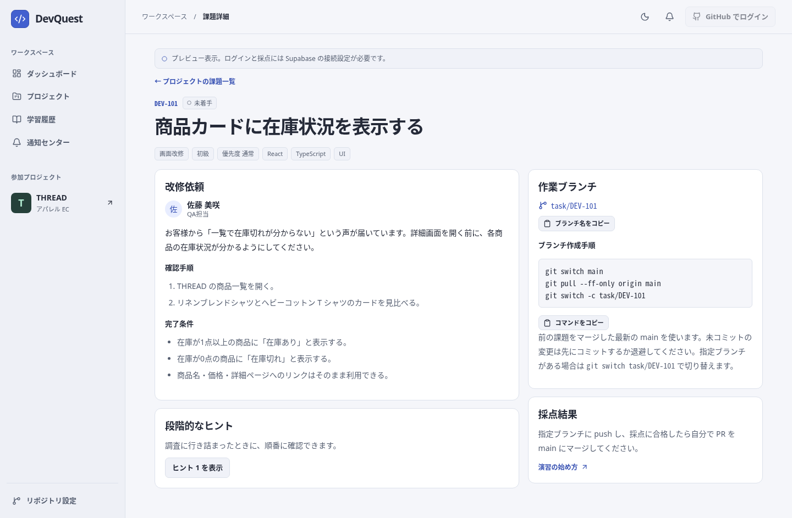
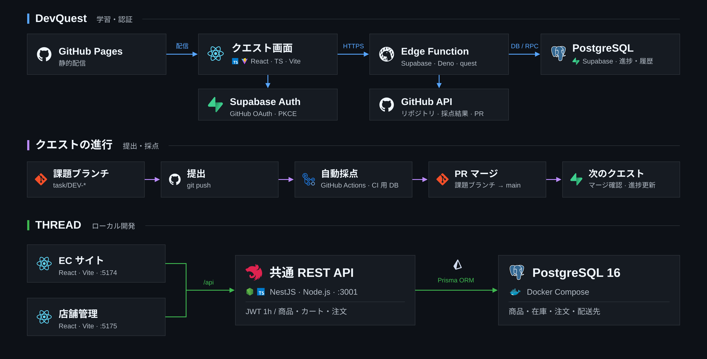

# DevQuest

THREAD の開発チームに途中参画し、改修依頼を受け取って自分のローカル環境で作業する演習アプリです。提出は GitHub Actions が採点します。合格後は自分で PR を main にマージし、DevQuest で完了を確認します。

- DevQuest 本体は React、TypeScript、Vite と Supabase で構成します。
- 演習コードと採点ワークフローは [THREAD テンプレート](https://github.com/okuda1506/devquest-fashion-template) にあります。商品のデータは演習者の PostgreSQL に保存され、DevQuest の DB とは独立します。
- 全4チャプターの計43件の課題（DEV-101〜143）を自動採点します。課題は DevQuest に表示される順に進めます。

## 学習者の環境構築

[DevQuest](https://okuda1506.github.io/devquest-app/) をブラウザで開いて初出勤を開始します。環境構築の場面で GitHub を連携してから、演習リポジトリを作成・登録します。手元で起動する THREAD の手順は [Windows（WSL 2 / Ubuntu）](https://github.com/okuda1506/devquest-fashion-template#windows) または [macOS](https://github.com/okuda1506/devquest-fashion-template#macos) を参照してください。

最初の PR をマージする前に、自分の演習リポジトリで [main のブランチ保護](https://github.com/okuda1506/devquest-fashion-template#main-のブランチ保護) を設定します。

## クエスト画面



ローカルのプレビュー表示で DEV-101 を開いた画面です。

## システムアーキテクチャ



### 本番環境の構成（サーバーレス）

DevQuest 本体は、専用のバックエンドサーバーを常時稼働させず、**GitHub Pages と Supabase を組み合わせたサーバーレス構成**で公開しています。

| サービス | 担当する役割 |
| --- | --- |
| **GitHub Pages** | React + TypeScript + Vite でビルドしたフロントエンド（HTML・CSS・JavaScript）を配信 |
| **`github.io`** | DevQuest の公開 URL を提供するドメイン（`https://okuda1506.github.io/devquest-app/`） |
| **Supabase Auth** | Google・GitHub ログインと認証セッションを管理 |
| **Supabase Edge Functions** | サーバー側の API 処理。GitHub API で採点結果や PR マージ状況を確認し、課題完了・次の課題解放を制御 |
| **Supabase PostgreSQL** | 学習者情報、課題進捗、提出履歴、通知などのデータを保存 |
| **GitHub Actions** | DevQuest のテスト・GitHub Pages へのデプロイ、学習者の THREAD リポジトリでの課題自動採点を実行 |

GitHub Pages は静的ファイルの配信を担当し、React アプリ自体は学習者のブラウザで動作します。採点結果の確認などのサーバー処理は Supabase Edge Functions が担当します。

学習者が THREAD の改修コードを push すると CI が動きます。CI を確認してから main への PR を開くと、GitHub Actions が課題を採点します。DevQuest の「採点結果を確認」で Edge Function が PR と最新コミットの結果を照合し、学習進捗を保存します。

なお、**THREAD は DevQuest 本体とは別の演習用システム**です。THREAD の EC サイト・管理画面（React）、API（NestJS）、DB（PostgreSQL）は学習者のローカル環境で起動し、Supabase の DB には THREAD の商品・在庫・注文データを保存しません。

## ローカル起動

Node.js 22.12 以上または 24 と npm を使います。

```sh
npm ci
npm run dev
```

接続情報がない場合は、課題一覧と初回チケットを閲覧できるプレビュー表示になります。ログインと採点を動かすには、以下の Supabase 設定を行ったうえで `.env.example` を `.env` にコピーし、`VITE_SUPABASE_URL` と `VITE_SUPABASE_ANON_KEY` を設定します。OAuth のリダイレクト許可には実際に開くオリジンを登録してください（例 `http://localhost:5173/`）。

```sh
npm run typecheck
npm run lint
npm test
bash scripts/test-db.sh
npm run build
```

DB テストは既存インスタンスから独立した一時的な PostgreSQL コンテナで実行します。RLS、採点合格からマージによる完了への遷移、次の課題の解放、通知の重複防止を検証します。GitHub API の判定はレスポンスの代替データを使ってテストします。Deno CLI がある場合は `deno check supabase/functions/quest/index.ts` で Edge Function の型を確認できます。

## 初回の公開設定

Google 登録・ログインへの移行は [Google 認証の公開手順](docs/google-onboarding-rollout.md) を参照してください。

1. THREAD リポジトリの GitHub **Settings → General** で **Template repository** を有効にします。Actions の利用も許可します。テンプレートは公開し、main を既定ブランチにします。
2. Supabase Free でプロジェクトを作り、GitHub の **Developer settings → OAuth Apps** で OAuth App を作成します。GitHub の **Authorization callback URL** には Supabase のプロバイダー画面に表示された `https://<project-ref>.supabase.co/auth/v1/callback` を登録します。Supabase **Authentication → Providers → GitHub** に GitHub の Client ID と Secret を入れます。
3. Supabase **Authentication → URL Configuration** の Site URL と許可する Redirect URLs に公開 URL を追加します。このリポジトリの既定の公開先は `https://okuda1506.github.io/devquest-app/` です。
4. Supabase CLI を公式手順でインストールしてログインし、このリポジトリで下記を実行します。テンプレートの SHA は採点用ファイルの基準にする公開済みコミットを指定します。初回は README を含む最新の main を使用します。

   ```sh
   supabase login
   supabase link --project-ref <project-ref>
   supabase db push
   supabase functions deploy quest
   ```

5. DevQuest リポジトリの **Settings → Secrets and variables → Actions → Variables** に `VITE_SUPABASE_URL` と `VITE_SUPABASE_ANON_KEY` を設定します。ここで使うキーはフロント向けの公開 anon キーです。**Settings → Pages → Source** を **GitHub Actions** にし、**Actions → DevQuest 検証と GitHub Pages 公開** を main で実行します。
6. 公開先で GitHub 連携、個人所有の公開テンプレートリポジトリの登録、DEV-101 の push と CI、PR 作成と採点、PR マージ、DEV-102 の解放と通知まで確認します。GitHub 側で「テスト用の空のリポジトリ」が作成された場合は、テンプレートから作成し直します。

OAuth の Secret と Supabase の service role キーはブラウザ用変数や Git に保存しません。PKCE コードの交換は Edge Function で実行し、ブラウザには Supabase セッションだけを返します。公開リポジトリの GitHub 情報は公開 API で確認し、GitHub に書き込む認可を学習者に要求しません。API レート制限が問題になる場合のみ、管理者がリポジトリへの読み取りに限定した `QUEST_GITHUB_READ_TOKEN` を Supabase の Edge Function Secrets に設定します。

GitHub でログインしたブラウザでは、同じ URL を開き直してもログインから1時間はセッションを再開できます。Supabase がアクセストークンを更新しても、この期限は延長されません。

## 採点・運用

Google の新規登録時は [プライバシーポリシー](https://okuda1506.github.io/devquest-app/#/privacy) への同意が必要です。公開前の通し確認、死活監視、問い合わせ調査、復元と切り戻しは [運用手順](docs/operations.md) を参照してください。

- `thread-quests-v10` は `task/DEV-101` から `task/DEV-143` の push で通常の CI を実行します。main への PR を開くと通常の検証に加えて課題条件と過去課題の回帰テストを実行し、PR に再 push があるたびに採点します。v9 以前で演習中なら作成時の方式で提出できます。
- Edge Function はログイン中の GitHub ユーザー ID、リポジトリ ID、指定ブランチの最新コミット、採点実行とその結論を照合します。PR 採点では PR 番号も照合します。採点専用ファイルは GitHub Actions と Edge Function の両方で照合し、合格した PR の main へのマージを確認して次を解放します。ブラウザから進捗・採点・通知を書き換える権限は付与しません。
- 学習者のリポジトリは公開されるため、業務コード、実際の顧客データ、秘密情報を置かないでください。採点は研修用途の公開テストで、機密の試験問題や完全な不正防止が必要な場合は、採点を独立したサービスに移してください。
- Edge Function は THREAD の分離前、`thread-split-v1`、`thread-checkout-v1` の各版の保護ファイル一式を認識します。分離版から演習中のリポジトリも、その版のまま提出できます。[購入手続きを取り込む場合の移行手順](https://github.com/okuda1506/devquest-fashion-template#旧版から演習を進めている場合)
- 採点基準を更新するときは、Actions の基準タグと Edge Function の承認済みコミットを計画的に更新します。追加の基準は Edge Function の `THREAD_TEMPLATE_SHA` に公開済みの40桁コミット SHA をコンマ区切りで指定できます。課題追加時はカタログ・DB の解放順・ワークフロー・回帰テストを揃えます。
- DEV-141〜143 の公開時は先に THREAD の `thread-quests-v3` を公開し、DevQuest の `supabase db push` と `supabase functions deploy quest` を順に反映します。DEV-140 完了済みの場合は DEV-141 を割り当てます。既存の演習リポジトリで続ける場合は [THREAD の採点更新手順](https://github.com/okuda1506/devquest-fashion-template#採点の更新すでに演習中の場合) に沿って v3 の変更を取り込みます。
- PR 採点版を公開する際は THREAD の `thread-quests-v10` タグを公開し、このリポジトリの `supabase functions deploy quest` を実行してから、THREAD のテンプレートの `main` を更新します。PR 採点への切り替えで DB マイグレーションは追加されません。
- Supabase の無料プロジェクトが一時停止した場合は、管理画面で再開して Edge Function と DB の疎通を確認します。個人データを含むため、バックアップはアクセスを制限した場所に保管し、復元後にリポジトリ ID、完了 SHA、通知件数を確認します。採点の再確認は同じ提出・通知を重複登録しません。

模擬決済対応版のスキーマと手順は、THREAD のコード構成を参照してください。[THREADのコード構成](https://github.com/okuda1506/devquest-fashion-template/blob/thread-quests-v9/docs/code-architecture.md)
